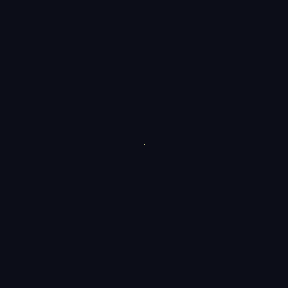
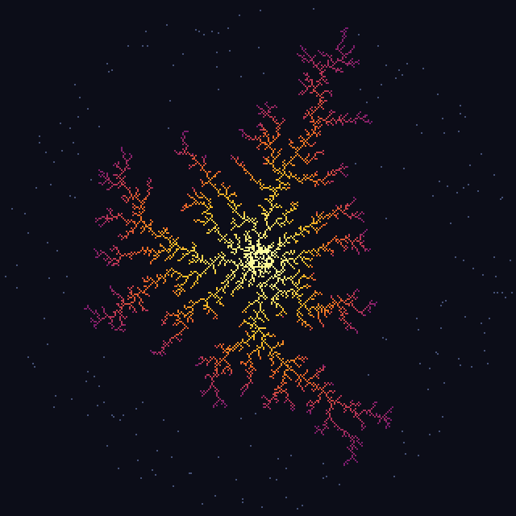
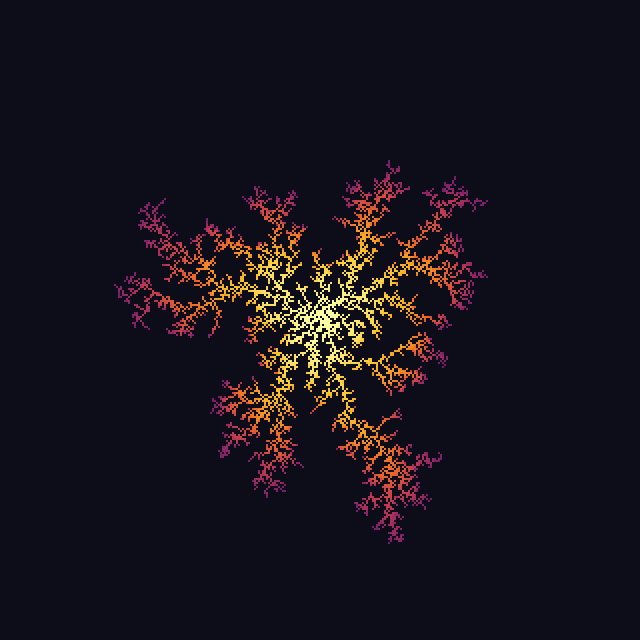
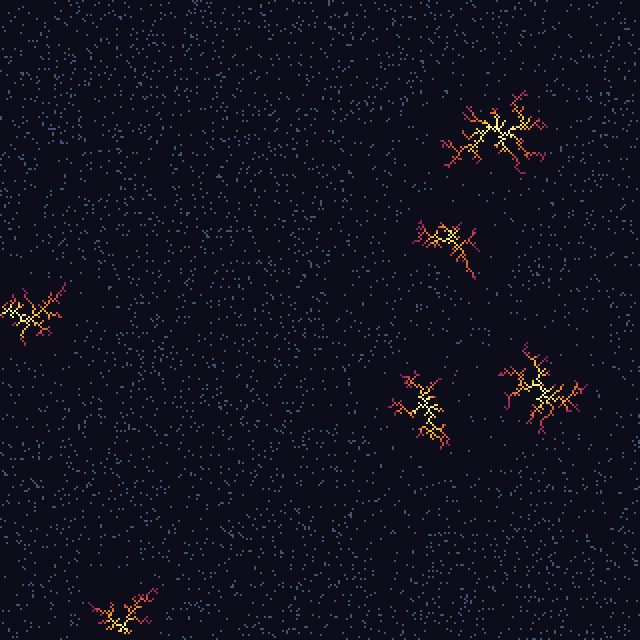

# Crystal Growth Simulation

**English** | [Deutsch](README_GER.md)

A fast C++ simulation of crystal growth by **diffusion-limited aggregation (DLA)**: particles wander randomly until they touch the crystal and freeze in place. Out of this simple rule grow branching, fractal structures like the ones found in snowflakes, mineral dendrites or electro-deposited metals.

<p align="center">
  
</p>

Colour shows age: the oldest part of the crystal glows pale yellow, the newest branches fade through orange to purple.

## How it works

- The world is a square grid. Each cell is empty, part of the crystal, or a *walker* (a free particle).
- Every step, each walker moves one cell up, down, left or right at random (a random walk / Brownian motion).
- A walker that touches the crystal (including diagonally) attaches to it, with probability `--stick`.
- Because walkers reach the tips of the crystal much more easily than its inner gaps, the tips grow faster. This is what makes the branches.

Two modes:

| `--mode radial` | `--mode radial --stick 0.1` | `--mode uniform` |
|---|---|---|
|  |  |  |
| One seed in the centre, walkers are released on a circle around the cluster: classic DLA fractal. | Walkers often bounce off before attaching, so they get deeper into the gaps: denser crystal. | Several seeds and all walkers spread over the grid from the start. |

📽️ [Full-resolution video](docs/media/dla_radial.mp4)

## Build & Run

Requirements: a C++20 compiler, CMake ≥ 3.25, Python 3 and ffmpeg.

### Live view

Watch the crystal grow in a window (uses [raylib](https://www.raylib.com), downloaded automatically on the first build):

```sh
# Windows
scripts\live.cmd --mode radial

# Linux / macOS
sh scripts/live.sh --mode radial
```

| Key | Action |
|---|---|
| `Space` | pause / resume |
| `Up` / `Down` | faster / slower (steps per frame) |
| `M` | switch mode (radial / uniform), also via the buttons at the top |
| `R` | restart with a new random seed |
| `S` | save a screenshot (`cristal_<seed>_<step>.png`) |
| `Esc` | quit |

In the live view there is no step or particle limit: radial mode grows until the crystal reaches the border, uniform mode until every walker has attached.

### Render a video

```sh
# Windows
scripts\run.cmd --mode radial

# Linux / macOS
sh scripts/run.sh --mode radial
```

This builds `build/release/bin/cristal`, writes frames to `out/frames/` and renders `out/output_video.mp4` (H.264).
All arguments are passed on to the simulation.

### Simulation options

| Option | Default | Meaning |
|---|---|---|
| `--mode M` | `uniform` | `uniform` or `radial` (see above) |
| `--size N` | 320 | grid width and height in cells |
| `--particles N` | 5000 | number of walkers |
| `--seeds N` | 6 | initial crystal seeds (uniform mode) |
| `--active N` | 200 | walkers on the grid at the same time (radial mode) |
| `--stick P` | 1.0 | probability that a walker attaches on contact, `0 < P ≤ 1` |
| `--steps N` | 2000 / unlimited | step limit (uniform / radial), `0` = unlimited |
| `--frames N` | 500 | number of frames to write, `0` = only the final frame |
| `--seed N` | random | random seed, same seed gives the same result |
| `--out DIR` | `out/frames` | directory for the frames |
| `--live` | off | show a window instead of writing frames (build preset `gui`) |

The simulation stops early when no walkers are left or the radial cluster reaches the border.

Video options: `python scripts/make_video.py --help` (fps, scale, `--cleanup`). The codec follows the file extension: `--output video.mp4` → H.264 (default), `--output video.webm` → VP9. `--encoder` overrides it, e.g. `--encoder h264_nvenc` for an NVIDIA GPU (avoid HEVC, many players and the VS Code preview cannot play it).

### Build and test only

```sh
cmake --preset release
cmake --build --preset release
ctest --preset release
```

Presets: `release`, `debug` (with bounds-checked containers), `gui` (release + live view) and `sanitize` (ASan/UBSan, GCC/Clang on Linux/macOS).

## Project Structure

```
src/         simulation, rendering, command line options, live viewer, main
tests/       unit tests (run with ctest)
scripts/     run scripts and video rendering
docs/media/  images and videos used in this README
```

## License

[MIT](LICENSE)
