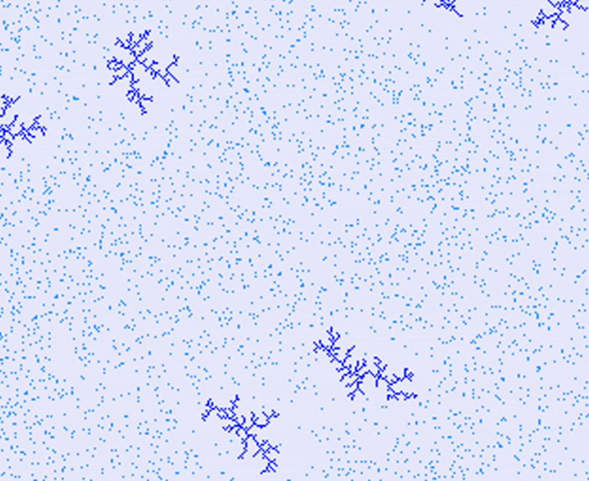

# Crystal Growth Simulation

Crystal growth simulations provide valuable insights into the microscopic world of materials. They help us understand the structure, behavior, and properties of crystalline substances-laying the groundwork for breakthroughs in materials science, chemistry, and physics.

These simulations are instrumental in the discovery of new materials and the optimization of existing ones. In industry, particularly in semiconductor manufacturing, such simulations can enhance product quality and process efficiency.

On a scientific level, crystal simulations enable a deeper understanding of phenomena such as phase transitions, magnetism, and electrical conductivity. By modeling atomic and molecular interactions in crystal lattices, they help predict and control material properties-paving the way for innovation in sectors like metallurgy, polymer science, and nanotechnology.

## Simulation Approach

### Diffusion-Limited Aggregation (DLA)

- Particles are randomly introduced and move in a random walk (Brownian motion).
- When they contact the growing structure, they attach to it.
- This mimics natural crystal growth under diffusion-limited conditions.

## Results

### DLA Simulation Output

## Demo Video

📽️ Watch a simulation of crystal growth in action:

[Crystal Growth Demo Video](results/output_video.mp4)
