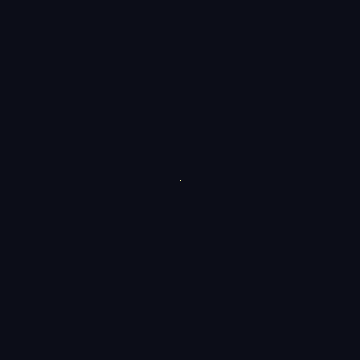
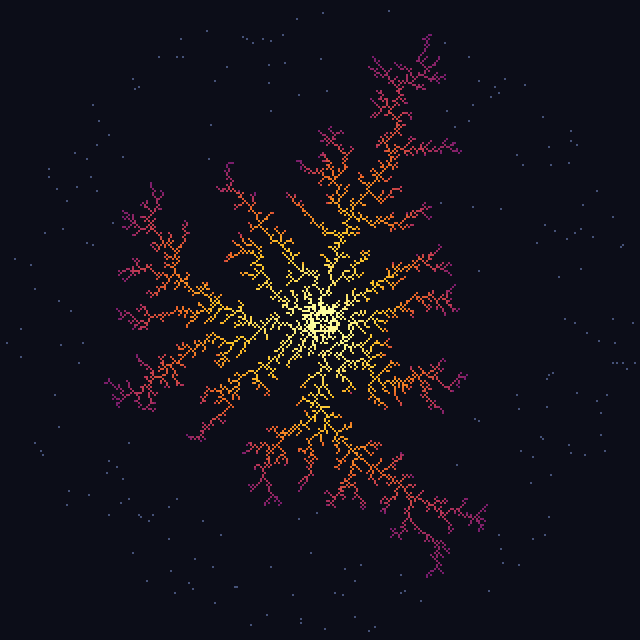
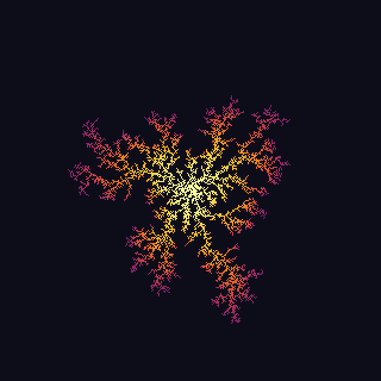
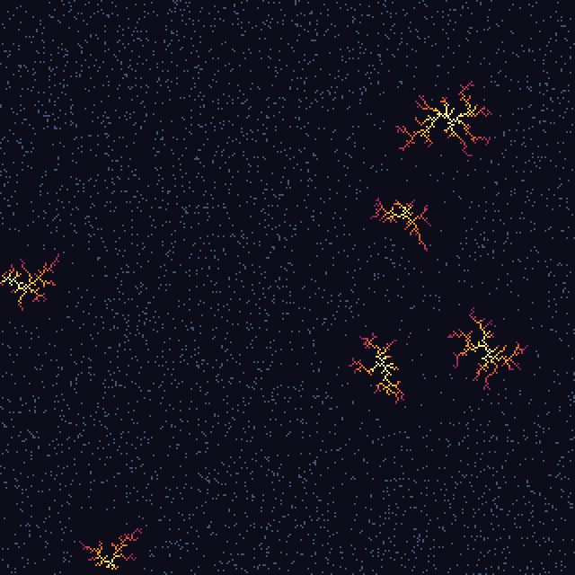

# Kristallwachstums-Simulation

[English](README.md) | **Deutsch**

Eine schnelle C++-Simulation von Kristallwachstum durch **diffusionsbegrenzte Aggregation (DLA)**: Teilchen wandern zufällig umher, bis sie den Kristall berühren, und bleiben dort hängen. Aus dieser einfachen Regel wachsen verästelte, fraktale Strukturen, wie man sie von Schneeflocken, Mineral-Dendriten oder galvanisch abgeschiedenen Metallen kennt.

<p align="center">
  
</p>

Die Farbe zeigt das Alter: Der älteste Teil des Kristalls leuchtet hellgelb, die neuesten Äste gehen über Orange in Violett über.

## So funktioniert es

- Die Welt ist ein quadratisches Gitter. Jede Zelle ist leer, Teil des Kristalls oder ein *Walker* (ein freies Teilchen).
- In jedem Schritt bewegt sich jeder Walker zufällig eine Zelle nach oben, unten, links oder rechts (Irrfahrt / Brownsche Bewegung).
- Ein Walker, der den Kristall berührt (auch diagonal), lagert sich mit der Wahrscheinlichkeit `--stick` an.
- Weil Walker die Spitzen des Kristalls viel leichter erreichen als die Lücken dazwischen, wachsen die Spitzen schneller. So entstehen die Äste.

Zwei Modi:

| `--mode radial` | `--mode radial --stick 0.1` | `--mode uniform` |
|---|---|---|
|  |  |  |
| Ein Keim in der Mitte, Walker starten auf einem Kreis um den Cluster: klassisches DLA-Fraktal. | Walker prallen oft ab, bevor sie haften, und kommen so tiefer in die Lücken: dichterer Kristall. | Mehrere Keime, alle Walker von Anfang an über das Gitter verteilt. |

📽️ [Video in voller Auflösung](docs/media/dla_radial.mp4)

## Bauen & Starten

Voraussetzungen: ein C++20-Compiler, CMake ≥ 3.25, Python 3 und ffmpeg.

### Live-Ansicht

Den Kristall in einem Fenster wachsen sehen (nutzt [raylib](https://www.raylib.com), wird beim ersten Build automatisch heruntergeladen):

```sh
# Windows
scripts\live.cmd --mode radial

# Linux / macOS
sh scripts/live.sh --mode radial
```

| Taste | Aktion |
|---|---|
| `Leertaste` | Pause / weiter |
| `Pfeil hoch` / `Pfeil runter` | schneller / langsamer (Schritte pro Bild) |
| `M` | Modus wechseln (radial / uniform), geht auch über die Buttons oben |
| `R` | Neustart mit neuem Zufalls-Seed |
| `S` | Screenshot speichern (`cristal_<seed>_<step>.png`) |
| `Esc` | Beenden |

In der Live-Ansicht gibt es kein Schritt- oder Teilchen-Limit: Im radialen Modus wächst der Kristall bis zum Rand, im uniform-Modus, bis alle Walker angelagert sind.

### Video erzeugen

```sh
# Windows
scripts\run.cmd --mode radial

# Linux / macOS
sh scripts/run.sh --mode radial
```

Das baut `build/release/bin/cristal`, schreibt die Einzelbilder nach `out/frames/` und erzeugt `out/output_video.mp4` (H.264).
Alle Argumente werden an die Simulation weitergegeben.

### Simulations-Optionen

| Option | Standard | Bedeutung |
|---|---|---|
| `--mode M` | `uniform` | `uniform` oder `radial` (siehe oben) |
| `--size N` | 320 | Breite und Höhe des Gitters in Zellen |
| `--particles N` | 5000 | Anzahl der Walker |
| `--seeds N` | 6 | Anzahl der Startkeime (uniform-Modus) |
| `--active N` | 200 | gleichzeitig aktive Walker (radial-Modus) |
| `--stick P` | 1.0 | Wahrscheinlichkeit, dass ein Walker bei Kontakt haftet, `0 < P ≤ 1` |
| `--steps N` | 2000 / unbegrenzt | Schritt-Limit (uniform / radial), `0` = unbegrenzt |
| `--frames N` | 500 | Anzahl der Einzelbilder, `0` = nur das Endbild |
| `--seed N` | zufällig | Zufalls-Seed, gleicher Seed ergibt das gleiche Ergebnis |
| `--out DIR` | `out/frames` | Ordner für die Einzelbilder |
| `--live` | aus | Fenster statt Einzelbilder (Build-Preset `gui`) |

Die Simulation endet früher, wenn keine Walker mehr übrig sind oder der radiale Cluster den Rand erreicht.

Video-Optionen: `python scripts/make_video.py --help` (fps, Größe, `--cleanup`). Der Codec richtet sich nach der Dateiendung: `--output video.mp4` → H.264 (Standard), `--output video.webm` → VP9. Mit `--encoder` lässt er sich überschreiben, z. B. `--encoder h264_nvenc` für eine NVIDIA-Grafikkarte (HEVC besser vermeiden, viele Player und die VS-Code-Vorschau können es nicht abspielen).

### Nur bauen und testen

```sh
cmake --preset release
cmake --build --preset release
ctest --preset release
```

Presets: `release`, `debug` (mit Grenzprüfung der Container), `gui` (Release + Live-Ansicht) und `sanitize` (ASan/UBSan, GCC/Clang unter Linux/macOS).

## Projektstruktur

```
src/         Simulation, Rendering, Kommandozeilen-Optionen, Live-Ansicht, main
tests/       Unit-Tests (mit ctest ausführen)
scripts/     Startskripte und Video-Erzeugung
docs/media/  Bilder und Videos für diese README
```

## Lizenz

[MIT](LICENSE)
